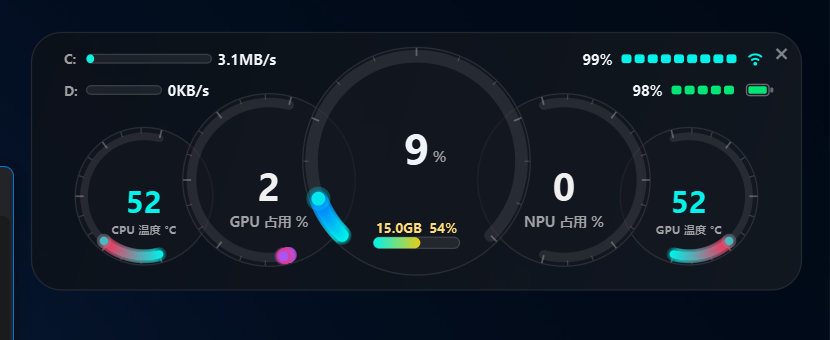

# Win11 Dash

一款 Windows 11 桌面悬浮硬件仪表盘：无边框、半透明、始终置顶，用五联发光弧线表盘实时展示 CPU / GPU / NPU 的状态，并在两侧同步显示内存、磁盘速率、WiFi 信号和电池电量。



## 功能特性

- **五联表盘**：CPU 温度、GPU 占用、CPU 占用（中央大表）、NPU 占用、GPU 温度，扇面朝内层叠排布，节省桌面空间
- **内存血槽**：内嵌在中央 CPU 表下方，显示已用容量（GB）与占用百分比
- **侧边信息条**：左上为 C:/D: 盘实时读写速率，右上为 WiFi 信号强度与电池电量（方块分格槽，与左侧对称）
- **托盘常驻**：托盘图标实时显示 CPU 温度，鼠标悬停查看整体负载摘要
- **无边框透明窗口**：支持拖动摆放、右键菜单切换置顶与透明度
- **自动提权**：双击启动时自动请求管理员权限，无需手动操作
- **开机自启**：通过任务计划程序实现，登录后静默以最高权限启动，不被 UAC 拦截

## 界面说明

### 表盘（从左到右）

| 位置 | 仪表 | 量程 | 说明 |
| --- | --- | --- | --- |
| 左一 | CPU 温度 | 30 ~ 110 °C | 低于 60 青色，60 ~ 75 黄色，75 ~ 90 橙色，90 以上红色 |
| 左二 | GPU 占用 | 0 ~ 100 % | 取 D3D 引擎中的最大负载 |
| 中央 | CPU 占用 | 0 ~ 100 % | 大字号读数为整数百分比，下方为内存血槽 |
| 右二 | NPU 占用 | 0 ~ 100 % | 仅统计 `engtype_Neural` 引擎，无 NPU 的机型显示 0 或 `--` |
| 右一 | GPU 温度 | 30 ~ 110 °C | 核显与 CPU 同 die 时，读数等同于 CPU 温度 |

### 侧边信息条

- **左上 C: / D:** — 该磁盘的实时传输速率（读 + 写合计），横槽为相对比例尺（自适应峰值，最低基准 50 MB/s，随时间缓慢回落），右侧数字为当前速率；无 D 盘时自动隐藏该行
- **右上 WiFi** — 当前无线信号质量（0 ~ 100 %）的方块分格槽，最右侧为信号图标
- **右上 电量** — 电池剩余电量的方块分格槽，低于 20 % 显示红色，低于 50 % 显示黄色，其余为绿色，最右侧为电池图标

## 系统要求

- Windows 11（Windows 10 21H2 及以上版本同样可以运行）
- **管理员权限**：读取 CPU / GPU 温度必须提权，程序启动时会自动弹出 UAC
- 源码运行需 Python 3.10+，另需 .NET Framework 4.7.2+（pythonnet 依赖）

## 快速开始

### 方式一：源码运行

```powershell
pip install PySide6 psutil pythonnet
python main.py
```

也可以直接双击 `启动仪表盘.bat`（使用 `pythonw` 启动，不保留控制台窗口）。

> 依赖 `lib/` 目录下的 LibreHardwareMonitor 组件，请勿删除该目录。

### 方式二：打包为 exe

```powershell
pip install pyinstaller
python -m PyInstaller --noconfirm Win11Dash.spec
```

产物为 `dist\Win11Dash.exe`（单文件、带管理员清单、无控制台）。仓库不附带编译好的二进制文件，请自行打包。

## 托盘与快捷操作

| 操作 | 效果 |
| --- | --- |
| 拖动窗口 | 移动仪表盘位置 |
| 点击右上角 `×` | 最小化到托盘（首次会弹出提示气泡） |
| 双击托盘图标 | 重新显示仪表盘 |
| 托盘右键 → 显示 / 隐藏 | 切换窗口可见性 |
| 托盘右键 → 开机自启 | 勾选后通过任务计划程序注册开机启动 |
| 托盘右键 → 退出 | 关闭程序并释放传感器 |
| 窗口右键 → 置顶 | 切换置顶状态 |
| 窗口右键 → 透明度 | 50% / 80% / 100% 三档 |
| 窗口右键 → 最小化到托盘 / 开机自启 / 退出 | 与托盘菜单等效 |

## 数据来源

| 数据项 | 采集通道 | 需要管理员 |
| --- | --- | --- |
| CPU 温度 | LibreHardwareMonitor（CPU Package / Core 平均）→ MSR 0x19C 直读 → Core Temp 共享内存兜底 | 是 |
| CPU 占用 | LibreHardwareMonitor `CPU Total` → psutil 兜底 | 否 |
| GPU 占用 | LibreHardwareMonitor D3D 引擎负载 | 否 |
| GPU 温度 | LibreHardwareMonitor `GPU Core`，核显复用 CPU 温度 | 是 |
| NPU 占用 | PDH `\GPU Engine(*)\Utilization Percentage`，筛选 `engtype_Neural` | 否 |
| 内存占用 | LibreHardwareMonitor Memory Load，已用容量取 psutil | 否 |
| 磁盘速率 | PDH `\LogicalDisk(C:)\Disk Read/Write Bytes/sec`（英文计数器名，兼容中文系统） | 否 |
| WiFi 信号 | `wlanapi.dll` 的 `wlanSignalQuality`，`netsh` 兜底 | 否 |
| 电池电量 | psutil `sensors_battery()` | 否 |

刷新节奏：界面动画 30 ms 重绘，传感器数据约 1 秒一次，磁盘 / WiFi / 电量等慢变数据每 5 个周期刷新一次。

## 项目结构

```
win11dash/
├── main.py                  # 入口，自动提权与异常日志
├── dashboard.py             # 窗口、五联表盘绘制、托盘与自启
├── sensor.py                # 传感器采集（LHM / PDH / wlanapi）
├── Win11Dash.spec           # PyInstaller 打包配置
├── app.ico                  # 应用图标
├── 启动仪表盘.bat           # 源码方式快速启动
├── lib/                     # LibreHardwareMonitor 运行库（打包必需）
├── docs/
│   ├── screenshot.png       # 界面截图
│   └── 使用说明.md          # 详细操作与排障手册
├── cluster_preview.png      # 早期布局预览
└── cluster_preview2.png
```

## 已知限制

- 未以管理员身份运行（或拒绝 UAC）时，温度类读数可能显示 `--`
- 没有 NPU 的机型，NPU 表盘没有可用数据
- 笔记本风扇转速缺少通用读取接口，未纳入显示
- 磁盘横槽是自适应峰值的相对比例尺，不是固定量程，空闲时会回落到较低基准
- 温度传感器由主板 / 驱动决定，个别机型可能读不到某些项目

## 更多文档

操作细节、常见问题与卸载方法见 [使用说明](docs/使用说明.md)。

## 许可证

暂未指定。
